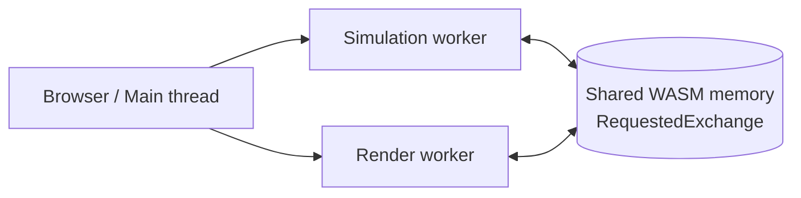
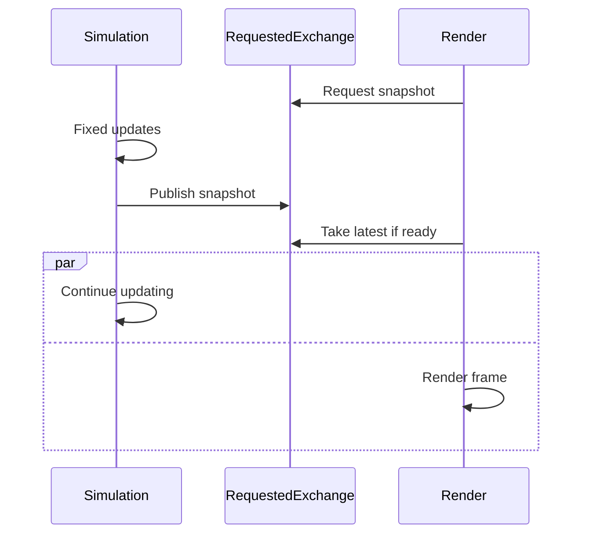

# Riviera Engine

**Riviera Engine is the application-facing C++20 engine built on top of
[riviera-engine-core](https://github.com/algu1984/riviera-engine-core).**
Core provides reusable ECS, jobs, simulation clocks, math, transforms, and
cross-thread data exchanges. Engine connects those foundations to a browser
runtime, rendering, scene management, physics, UI, and audio output.

The architectural highlight is a **three-lane, shared-memory WebAssembly
host**: browser/main, simulation, and rendering can each do their own work.
The WebGPU renderer demo demonstrates demand-driven extraction, where the
render loop does not have to wait for a new simulation packet.

## Browser architecture

The [web host](src/platform/web/host.cpp) creates two Emscripten
`pthread` workers: one for simulation and one for rendering. Emscripten maps
these to browser Web Workers that share the application's WebAssembly memory
(`SharedArrayBuffer`); the render worker receives the canvas and runs WebGPU
on an `OffscreenCanvas`. The main browser thread handles DOM-facing work,
input, and viewport publication.

This requires a **pthread-enabled WASM build** and a cross-origin-isolated
browser context (COOP/COEP). Worker creation, platform loops, GPU access, and
canvas ownership live in **Engine**, not Core.

### How simulation overlaps rendering

The [WebGPU renderer demo](examples/webgpu-renderer-demo/main.cpp) uses
Core's `FixedStepClock` and a single shared
`RequestedExchange<DrawBatch>` object:

The demo's simulation loop advances fixed steps independently of the render
callback. Extraction (`produce`) runs **only when requested**, rather than
on every simulation tick. The renderer calls `acquire()` without blocking:
if no new packet is ready, it retains the previous packet and keeps rendering.
A two-slot reusable exchange provides data handoff without copying whole
packets through JavaScript `postMessage`. This is a **demo of the integration
pattern**, not a claim that every application or the engine's `Scene` uses
this exchange automatically.

The demo also measures frame cadence, CPU render time, simulation time,
extraction counts, allocation growth, and **packet age** (time since extraction)
to make synchronization and latency visible.

## What Engine implements

| Subsystem | Available functionality |
| --- | --- |
| **Browser host** | Main-thread browser services, input and viewport handling, two pthread workers, independent simulation/render scheduling, and OffscreenCanvas transfer ([`host.cpp`](src/platform/web/host.cpp)). |
| **WebGPU renderer** | Forward rendering, shadows, sky, MSAA resolve, UI passes, material/mesh interfaces, and glTF geometry/material plus PNG/JPEG texture import ([`renderer.hpp`](include/engine/renderer.hpp)). |
| **Frame graph** | Pass and resource-dependency validation, version tracking, dead-pass pruning, and compatible transient texture slot reuse ([`frame_graph.hpp`](include/engine/graphics/frame_graph/frame_graph.hpp)). |
| **Scene** | Graphics-facing ECS entities, parent/child transforms, visibility, mesh instances, and caller-owned draw extraction ([`scene.hpp`](include/engine/scene/scene.hpp)). |
| **Jobs executor** | Engine-facing executor built on Core's general task scheduler, with optional host-provided worker execution ([`executor.hpp`](include/engine/jobs/executor.hpp)). |
| **Physics service** | Single-owner Jolt `PhysicsWorld` wrapper with physics system, temporary allocator, and Jolt job system; applications own collision policy, bodies, and gameplay rules ([`physics_world.hpp`](include/engine/physics/physics_world.hpp)). |
| **UI and audio** | Reusable C++ canvas/layout UI and browser AudioWorklet PCM transport ([`canvas.hpp`](include/engine/ui/canvas.hpp), [`engine-worklet.js`](web/engine-worklet.js)). |

**Core versus Engine:** Core owns the ECS data model and scheduling,
fixed-step clock, generic task graph, math, hierarchy algorithm, and
`RequestedExchange`/`SnapshotExchange` primitives. Engine owns the Web
worker setup, renderer, graphics scene integration, WebGPU frame graph,
physics adapter, and browser services. Applications own gameplay-specific
simulation, cars and tires, assets, collision rules, and audio synthesis.

**Current limits:** the browser host exists, but a native host and an editor
are not provided. The renderer uses WebGPU's implicit transitions rather
than an explicit backend barrier layer; GPU-driven culling, indirect drawing,
and mesh shaders are not implemented. The `Scene` exposes ECS storage, but
not every game subsystem is necessarily migrated to the ECS system scheduler.
See [current implementation status](docs/ENGINE_STATUS.md) for the precise scope.

## Demo and documentation

Explore the [live WebGPU demo](https://algu1984.github.io/riviera-engine/)
or see the [performance measurements](docs/PERFORMANCE.md).
For commands and setup requirements, see **[Build and tests](docs/BUILD.md)**.
For design rationale, see [Engine design](docs/ENGINE_DESIGN.md),
[Engine status](docs/ENGINE_STATUS.md), and
[dependency pins and patches](dependencies/README.md).

## License

Riviera Engine's authored code is released under the [MIT License](LICENSE).
Third-party dependencies retain their own licenses and notices (including
the demo's cgltf/stb licenses). UI test font fixtures retain their own OFL
notices under `tests/assets/fonts`.
