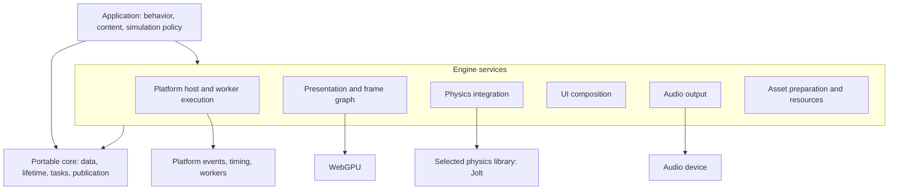
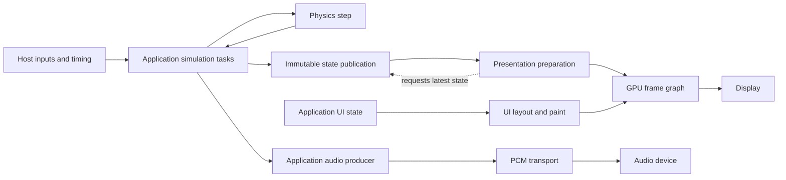

# Riviera Engine — High-Level Design

## Purpose and boundary

Riviera Engine connects the portable core to platforms and devices. Its role is
to turn application state into visible frames, audible output, and physics
results while preserving the core's data and execution model.

The architecture has three responsibility layers. The
[core HLD](../../riviera-engine-core/docs/CORE_DESIGN.md) owns dense entity storage, system access scheduling, structural command
boundaries, relationships, task dependencies, time, and publication. The
engine owns reusable runtime services and integrations. The application owns
behavior, content, simulation policy, and the meaning of its entities.

Dependencies point toward the core and selected libraries, never back into the
application. Engine services must not know what a vehicle, tire, road, or engine
sound means. Splitting repositories does not create a process boundary: native
and WebAssembly builds can link the same C++ objects without mandatory copies,
RPC, or duplicated JavaScript state.

This HLD describes the architecture and its direction. The
[implementation status](ENGINE_STATUS.md) records which capabilities exist today;
future extensions below are proposals, not claims of current support.

## Platform integration

A platform host supplies input events, elapsed time, viewport information, worker
execution, graphics surfaces, and audio output. The application interprets events
and chooses runtime policy. Platform-specific behavior stays behind the engine
boundary so that it does not enter core storage or scheduling algorithms.

The current host is the browser. Its main thread owns DOM input, viewport
measurement, browser storage and other privileged browser calls. A render pthread
owns WebGPU, the transferred OffscreenCanvas, and its requestAnimationFrame loop.
A second pthread owns simulation initialization and its timer-driven pump. Both
workers share the C++ WebAssembly memory with the main thread; bounded queues and
published snapshots carry data across owners. JavaScript connects the C++ host to
browser facilities that require JavaScript. Native graphics and mobile hosts
remain future work.

Browser input enters a fixed-capacity single-producer/single-consumer queue for
render-side UI. A separate optional main-thread observer lets applications publish
physical driving input directly to simulation-owned atomic state, independent of
render queue latency. If the UI queue fills, its next drain discards stale events
and emits `FocusLost`; the observer receives that reset immediately. Viewport
measurements are published as an atomic snapshot, and the render owner resizes its
OffscreenCanvas. Cross-thread browser services use asynchronous main-thread
dispatch; synchronous storage reads are intended for startup before worker launch.

WebGPU is the selected graphics API. Device and surface lifecycle belong to the
renderer and host. Asynchronous device initialization, resizing, and recovery
must be coordinated with resource ownership and submission. Calls with platform
or device affinity stay on an appropriate execution lane; arbitrary worker access
to graphics objects is not implied by a parallel task scheduler.

## Execution and data flow

CPU work follows the core task graph rather than assigning all work to one loop.
In the browser, the host reserves a render owner and a simulation owner alongside
the responsive main browser thread. Other CPU work can use the core task graph;
task dependencies express when results become available.

Simulation, presentation, and audio have different cadences. Simulation advances
in fixed steps. Presentation consumes published state when a frame is requested.
The audio device consumes prepared PCM at its own callback cadence. These
boundaries keep a delayed frame from redefining the simulation step or interrupting
audio generation.

This is an architectural data-flow model, not a mandatory graph assembled by the
engine for every application. The application chooses captured state, task
ordering, and the input used by its audio producer. In the browser, the main
thread publishes input events and viewport snapshots; the simulation pump decides
fixed-step policy from elapsed time, and the render loop consumes the latest
presentation state when a display frame is requested. Timer cadence is a wakeup
policy, not a simulation timestep. A subsystem may run serially where ordering or
its underlying library requires it.

CPU task dependencies and GPU pass dependencies are distinct. CPU tasks prepare
results; the frame graph arranges work on the graphics device. One graph does not
replace the other's lifetime and visibility rules.

## Presentation and rendering

The renderer consumes presentation data: transforms, mesh references, materials,
camera state, lights, and UI paint. It owns GPU resources and submission. The
application owns scene meaning and rendering choices specific to its content.

Entity relationships and transform propagation remain core concerns. ECS systems
declare access through their parameters; ordinary component fields are protected
by the schedule, and structural changes are applied through command boundaries.
Render extraction publishes immutable presentation data instead of borrowing a
live mutable world across simulation updates. Rendering extracts the data it needs
rather than making renderer objects the authoritative simulation world. The existing scene service owns a rendering-oriented core ECS
world; it is not yet a generic view over any application world. A unified
application-world view is a possible extension and should reuse core relationships
instead of introducing a mirrored hierarchy.

The frame graph expresses passes and their resource inputs and outputs. From
those declarations, compilation derives ordering, eliminates unused work, and
identifies compatible transient resources with nonoverlapping lifetimes. External
resources and history have explicit owners. Pass code must respect its declared
accesses; hidden dependencies cannot be recovered by the graph.

WebGPU performs resource transitions. Transient reuse means reusing compatible
textures; it does not imply native heap aliasing, explicit Vulkan barriers, or
independent GPU queues. Those are backend capabilities requiring separate support.

The current rendering path is forward PBR. A deferred path would be a different
set of passes, resource layouts, and material interfaces within the same frame
graph architecture. It can be introduced without changing core, but is not present
merely because a graph exists. GPU culling, LOD selection, and indirect submission
are future optimizations gated by target capabilities and measured workloads.

## Physics integration

Physics belongs in the engine as an optional integration with a selected library.
The integration owns a physics world and its execution resources; the application
owns body construction, collision policy, gameplay constraints, and the mapping
between simulation entities and physics objects.

Jolt is the current choice. It preserves the application's existing C++ physics
and vehicle integration and can be built for the current WebAssembly target and
native CPU validation. The current interface exposes Jolt concepts directly.
Backend-neutral physics and runtime backend switching would require a new
interface; they are not implicit in the repository split.

Each physics world has one owner for stepping and mutation. The simulation task
orders inputs, advances that world, and makes its results available to downstream
work. Separate worlds can be scheduled independently. The application's cadence
and publication model remain outside the physics adapter.

ECS is not the internal representation of every engine service. A physics-body
component may hold a Jolt body handle while Jolt owns its bodies and acceleration
structures. A complex vehicle may remain an ordinary C++ object. Such services can
submit ordinary task-graph jobs without depending on the ECS system scheduler.

Entity/component ownership does not make a third-party physics world lock-free.
Jolt retains internal synchronization, and its current integration uses the
regular body interface. This is an explicit boundary around the core's algorithmic
guarantees. Placing Jolt in the engine does not itself add a copy of the whole ECS;
the application chooses which values cross the physics boundary and which state is
authoritative.

## UI and audio

UI composition is a C++ service that transforms application state into layout,
hit-test information, and paint data. It uses the renderer for output and consumes
events relayed from the main-thread host. Application screens, text, styling, and
interaction policy remain application data. Browser DOM layout is not the
authority for engine UI.

Audio output accepts prepared PCM and delivers it to the device with bounded
buffering and observable underruns. The device callback must not depend on the
next simulation or render frame completing. Generation, mixing policy, and sound
selection are producer responsibilities. A vehicle sound simulator is application
behavior, not a dependency of the reusable engine or core.

The browser adapter connects the producer to an AudioWorklet for PCM output.
Operations requiring a transient user activation, such as resuming audio, must be
performed by a main-thread gesture callback. Other platforms would supply their
own device adapter. Changes to the output adapter should not require rewriting
synthesis or making it depend on JavaScript.

## Assets and resource ownership

Content is owned by the application. The engine owns generic decoding, resource
creation, and the lifetime of uploaded resources. A content name is metadata,
not a signal to apply vehicle- or game-specific behavior.

The current renderer imports models and images directly. The intended extension
is a separate preparation pipeline: source content is converted to versioned
runtime data, cached by content and processing configuration, and loaded through
explicit resource ownership. Cooking, persistent caching, streaming, and hot
reload are future work and should remain separate from the rendering loop.

Reload requires publishing a complete replacement while retaining resources
still used by consumers. CPU ownership alone does not prove GPU completion;
resource retirement must also respect outstanding device work. This lifecycle
rule applies whether assets come from direct import or a future cooked format.

## Lifecycle and fault boundaries

The host initializes services before publishing work that uses them. Device
services and third-party libraries own their initialization requirements;
application state cannot become usable until its required resources are ready.

Shutdown stops new work, completes or releases accepted consumers, and tears down
services after their users. Worker joining is host lifecycle behavior and can
block; it is not part of the portable scheduler's lock-free readiness algorithm.
The current Jolt initialization is a process-startup operation, not a fully
restartable service lifecycle.

Failures remain local where possible. A failed preparation task cannot feed a
dependent pass; unavailable publication capacity should not stall simulation;
an audio underrun is reported by output transport. Graphics device recovery,
asset replacement, and application resets require explicit policy rather than
an assumption that all services share one frame-wide transaction.

## Key decisions and evolution

| Decision | Architectural consequence |
| --- | --- |
| Portable core below host and device services | Platform choices cannot enter the ECS or task algorithms. |
| Dependency-driven CPU execution | Parallelism follows available work; affinity and worker lifecycle remain host concerns. |
| Published state between different cadences | Simulation, display, and audio can progress independently with explicit ownership. |
| WebGPU and a declarative frame graph | Rendering paths can evolve through passes; backend features remain capability-dependent. |
| Jolt-specific physics integration today | Existing physics can be reused; interchangeable backends require a deliberate interface change. |
| Application-owned behavior and content | The engine stays reusable across applications without car or sound-simulator dependencies. |

Near-term architectural work should close concrete gaps in these boundaries:
presentation views over application worlds, deliberate parallel task composition,
and measured resource-lifetime management. Native hosts, richer rendering paths,
asset tooling, and editor services can then extend the engine without expanding
the portable core into a platform or game framework.
